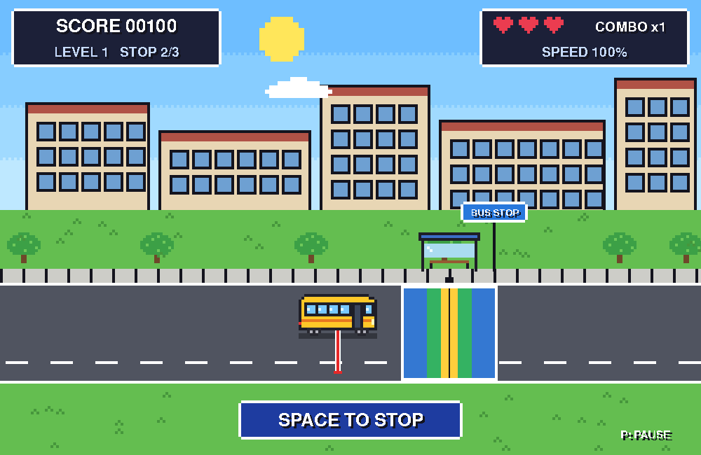

# Campus Bus Challenge (캠퍼스 셔틀 정차 챌린지)

Dự án cuối kỳ môn **Tư duy máy tính (컴퓨팅 사고)**: một game 2D viết bằng Python + Pygame,
kèm báo cáo tiếng Hàn theo mẫu 11 mục của môn học.



## Cách chơi

Xe buýt trường chạy ngang màn hình. Nhấn **Space** đúng lúc để dừng xe sao cho **tâm xe**
(vạch đỏ dưới thân xe) trùng với **tâm trạm** (vạch đen giữa vùng màu).

| Khoảng lệch | Hạng | Điểm |
|---|---|---|
| ≤ 12 px | PERFECT | 100 + thưởng combo (tối đa 200) |
| ≤ 32 px | GOOD | 60 |
| ≤ 65 px | OK | 30 |
| > 65 px | MISS | 0, mất 1 mạng |

- Có 3 mạng. Mỗi màn gồm 3 trạm; xe nhanh dần theo công thức `min(260 × 1.15^(level−1), 520)` px/giây.
- Bối cảnh đổi theo màn: buổi sáng → buổi chiều → buổi tối, sau đó lặp lại.
- Phím điều khiển:

  | Phím | Tác dụng |
  |---|---|
  | Enter | Bắt đầu |
  | Space | Dừng xe |
  | P | Tạm dừng / tiếp tục |
  | R | Chơi lại |
  | Esc | Thoát |

## Chạy game

Yêu cầu Python 3.10 trở lên. Đã chạy thử với Python 3.13.5 và pygame 2.6.1.

```bash
cd campus-bus-challenge
python3 -m venv .venv
source .venv/bin/activate          # Windows: .venv\Scripts\Activate.ps1
pip install -r requirements.txt
python "20231855- 팜 응옥 아잉- FinalProject.py"
```

Chạy kiểm thử (27 test cho luật chơi):

```bash
python -m unittest discover -s tests -v
```

## Cấu trúc thư mục

```
campus-bus-challenge/
  20231855- 팜 응옥 아잉- FinalProject.py   # toàn bộ game: 5 hàm chính init / handle_input / update_game / render / run_game
  tests/test_rules.py    # kiểm thử luật chơi (unittest)
  requirements.txt
  README.md              # hướng dẫn chi tiết, luật chơi, hạn chế đã biết
  DEV_NOTES.md           # nhật ký dùng AI và các lỗi đã gặp, đã sửa
report/
  FinalProject_Report.docx   # báo cáo tiếng Hàn (11 mục)
  images/                    # ảnh màn hình và lưu đồ dùng trong báo cáo
Campus_Bus_Game_Implementation.md   # đặc tả triển khai
```

## Ghi chú

- Đồ họa pixel-art được vẽ hoàn toàn bằng code Pygame, không dùng file ảnh hay âm thanh bên ngoài.
- Game được phát triển với sự hỗ trợ của AI (Claude Code). Quá trình sử dụng AI được ghi lại trong `DEV_NOTES.md` và mục 8 của báo cáo.
